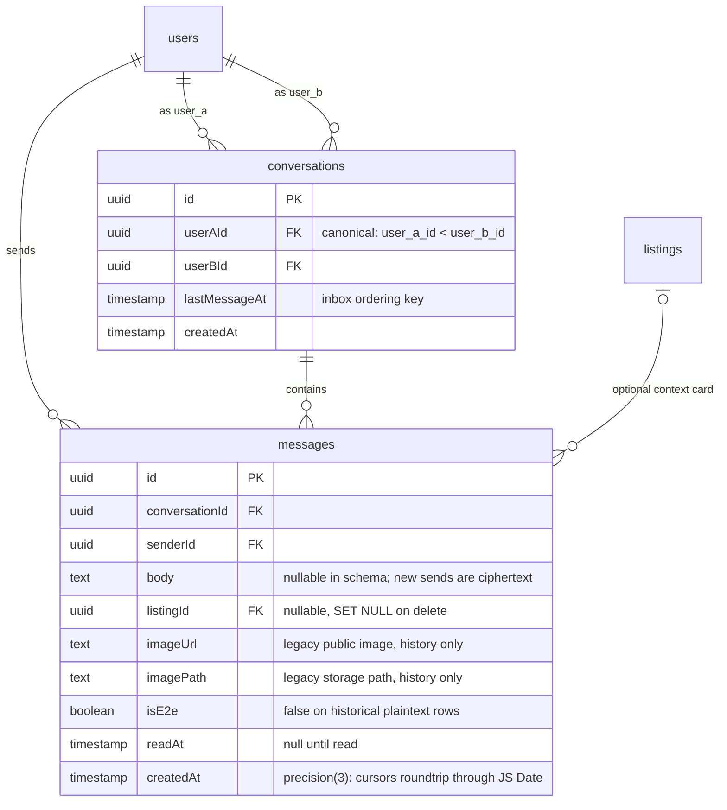
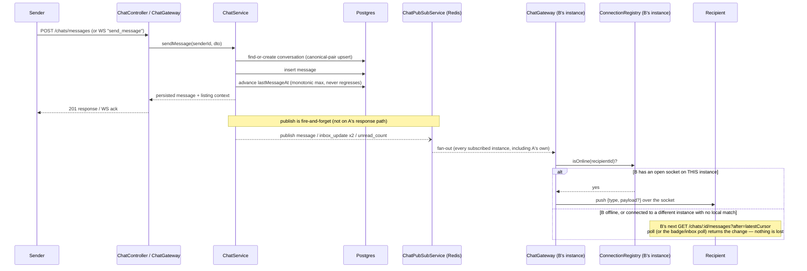
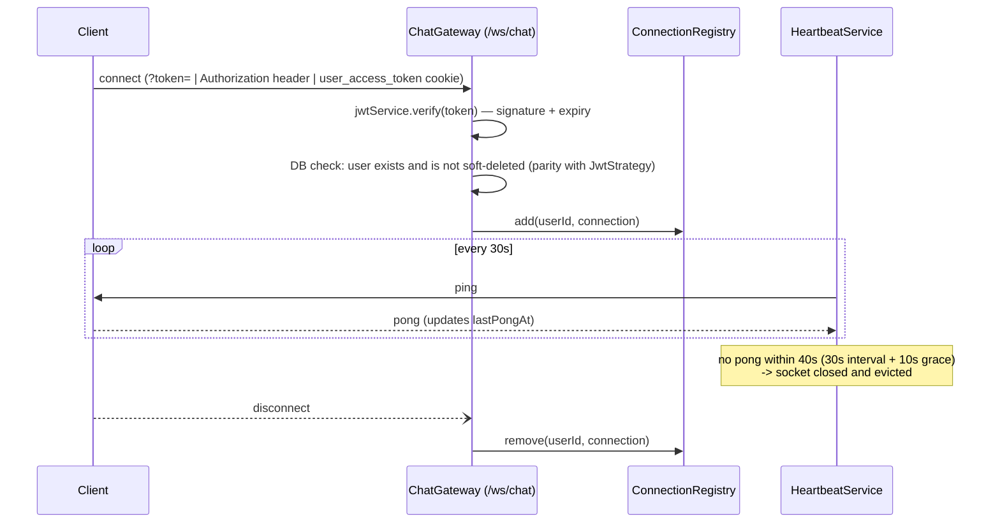

# Chat module

1:1 buyer↔seller messaging. REST is the source of truth for every read and
write; a WebSocket gateway sits alongside it as an optional low-latency push
— not a replacement for polling, a shortcut on top of it.

## Architecture

### REST is authoritative, the socket is a shortcut

Every message is written through `ChatService.sendMessage`, whether the
request arrived over `POST /chats/messages` or the WS `send_message` event —
the gateway calls the exact same service method, so validation (self-message,
encrypted-only payload, required body, blocked pair, listing ownership) only
exists once. The socket's only job on top of that write is: if the recipient
happens to have an open connection _to this process_, push the already-
persisted message to them immediately. If they don't — wrong node, offline,
REST-only client — nothing is lost, because the client's next
`GET /chats/:id/messages?after=<latestCursor>` poll picks it up. The socket
is a latency optimization on a system that already works without it.

### Files

| File                            | Purpose                                                                                                                                                                                                                                                               |
| ------------------------------- | --------------------------------------------------------------------------------------------------------------------------------------------------------------------------------------------------------------------------------------------------------------------- |
| `chat.controller.ts`            | REST surface: send, inbox, unread-count, resolve-with-user, message history/poll, mark-read.                                                                                                                                                                          |
| `chat.service.ts`               | All persistence + business rules. The single write path for a message, REST or WS; rejects any unencrypted write. Publishes realtime events after every send / mark-read.                                                                                             |
| `chat.gateway.ts`               | WebSocket gateway (`/ws/chat`). Authenticates the socket (JWT + soft-delete check), rate-limits and validates `send_message`, relays it into `ChatService`, answers each send with one `ack` or `error` frame, and delivers push events to locally-connected sockets. |
| `chat-pubsub.service.ts`        | Redis pub/sub wrapper (reuses the BullMQ Redis connection). Fans a `message` / `inbox_update` / `unread_count` / `read` event out to every backend instance so a recipient connected to a different process still gets realtime delivery.                             |
| `connection-registry.ts`        | In-memory `userId -> sockets` map for this process. Answers "is this user online, and on which socket(s)." — always process-local; cross-instance reach comes from `chat-pubsub.service.ts`.                                                                          |
| `heartbeat.service.ts`          | Pings every open socket every 30s; closes and evicts any that hasn't ponged in 40s.                                                                                                                                                                                   |
| `chat.types.ts`                 | Response-shape interfaces (`InboxItem`, `MessageWithListing`, poll metadata) shared by the service and controller.                                                                                                                                                    |
| `chat-attachments.*`            | Encrypted attachments: create (upload URL, quota), complete (real size from storage), attach (inside the send transaction), participant-only signed download URLs, orphan cleanup. Private `chat-files` bucket; the server stores no keys, MIME types or hashes.      |
| `chat-maintenance.processor.ts` | BullMQ `chat-maintenance` queue: hourly `attachments-cleanup` (storage objects can't be removed by a DB cascade).                                                                                                                                                     |
| `e2e/`                          | E2E key relay: `e2e-keys.*` (v1 per-user keys), `e2e-devices.*` (v2 per-device keys + envelopes), `e2e-backup.*` (encrypted history backup + passcode unlock; device approval was removed 2026-10-26). Server sees only ciphertext.                                   |
| `dto/`                          | `SendMessageDto`, `QueryChatsDto`, `QueryMessagesDto` — request validation.                                                                                                                                                                                           |

DB schema lives in [`../db/schema/chat.schema.ts`](../db/schema/chat.schema.ts), not in this folder. Both tables live in a dedicated `chat` Postgres schema (`../db/schema/chat.pg-schema.ts`, mirroring `payment/entity/payment.pg-schema.ts`) rather than `public` — moved there in migration `0016_move_chat_tables_to_chat_schema`. The FKs into `public.users`/`public.listings` are unaffected; Postgres and Drizzle both handle cross-schema foreign keys with no special casing.

### Entity map

One `conversations` row per unordered pair, enforced by a CHECK
(`user_a_id < user_b_id`) plus a unique index on the pair — there is no
"start a new thread with the same person" possible, by construction.

New messages are encrypted-only. `sendMessage` rejects a payload carrying
neither an `e2eHeader` (v1) nor an `e2e` envelope (v2) — `Encrypted messages
are required` — requires a `body` (ciphertext), and rejects the legacy
public-bucket `imagePath` with `Unencrypted chat images are not accepted`.
`imageUrl`/`imagePath` stay in the schema because historical rows still
render, but nothing writes them any more. The web client seals a shared
location, a listing-only marker and a voice note's `purpose`/`durationMs`
inside the ciphertext (`khmer24-chat-content` v1 for the first two), so the
server only ever stores and relays ciphertext.

### Where this differs from the payment module's approach

Chat doesn't use the transactional outbox, and uses BullMQ for exactly one
thing: the hourly `attachments-cleanup` job (`chat-maintenance.processor.ts`),
because deleting a storage object is something no DB cascade can do. Every
message write is still synchronous, inline, in the request/WS-handler that
received it.
That works because chat has no external system whose failure must be
retried durably; the closest thing to an async fan-out step is the Redis
pub/sub publish in `chat-pubsub.service.ts`, and it's deliberately
best-effort **and non-blocking** (kicked off fire-and-forget; a publish
failure is logged and swallowed, never rethrown) — not durable like an
outbox row, because a dropped push just means the recipient sees the
change on their next poll instead of instantly. Keeping Redis off the
response path is intentional: the 201 / WS completion waits only on
Postgres, not on fan-out RTT.

## Lifecycle, end to end

### Sending and receiving a message

### WebSocket connection lifecycle

Key properties this gives us:

- **The socket can disappear entirely and nothing breaks.** Delivery
  correctness lives in the DB write + cursor polling; the socket only
  affects _how fast_ the recipient finds out.
- **Read receipts are pull-based, not pushed.** `markRead` bulk-updates
  `readAt`; the sender learns about it via `peerLastReadAt` on their next
  poll, not a socket event — there is no separate read-receipt push path
  today.
- **A forged/expired cursor can't leak across conversations.** Every cursor
  comparison is scoped inside a conversation the caller was already
  authorized for in the same query.

### Realtime hints for the encrypted backup

The socket carries one `notification` frame from `E2eBackupService` (type in
`e2e/e2e-push-events.ts`), so a tab does not have to poll for it. It goes through
`ChatPubSubService.publish` to every open tab of **the same user** after the write has
committed, carries **ids only** (never ciphertext, wrapped keys or plaintext), and is best-effort:
a publish failure is logged and never fails the request.

| `payload.type`       | When                               | `payload.data`            |
| -------------------- | ---------------------------------- | ------------------------- |
| `e2e.backup_updated` | a device uploaded a backup segment | `deviceId` (the uploader) |

The client (`apps/web/lib/e2e/push-events.ts`) turns it into an ordinary authenticated read, and
ignores an upload by its own device. A push is **never the source of truth**: while the socket is up the
client keeps a slow safety poll (5 min), and it catches up on every (re)connect, because a frame sent while
the socket was down is not replayed.

### Key availability, held sends and the nudge (2026-10-27)

| Rule / endpoint                          | Behaviour                                                                                                                                                                                                                                                                                                      |
| ---------------------------------------- | -------------------------------------------------------------------------------------------------------------------------------------------------------------------------------------------------------------------------------------------------------------------------------------------------------------- |
| Active device set                        | `loadTargetDevices` (`e2e/e2e-devices.util.ts`): non-revoked devices seen within 30 days, else the 2 most recently seen non-revoked devices. Used by `GET /chats/e2e/devices/:userId`, the bundle fetch and the send path's set check (fast read and locked re-read), so a sender and the server always agree. |
| `POST /chats/e2e/nudge/:userId`          | Body `{ listingId? }`. 404 unknown user, 403 blocked either way, `{ sent: false }` if this sender already nudged this recipient in the last 24 h, otherwise one `chat.e2e_nudge` notification with no body and no sender text. In-app only; no Telegram channel exists.                                        |
| `E2E_NO_RECIPIENT_DEVICES` (404 on send) | Now only for a recipient with no non-revoked device at all. The web client holds the message and retries instead of failing; see `docs/e2e-encryption.md` section 9b.                                                                                                                                          |

## Current state

| Piece                                                             | Status                                                                                                                                                                                                                                                                                                                |
| ----------------------------------------------------------------- | --------------------------------------------------------------------------------------------------------------------------------------------------------------------------------------------------------------------------------------------------------------------------------------------------------------------- |
| REST endpoints (send / inbox / unread / resolve / history / read) | Done.                                                                                                                                                                                                                                                                                                                 |
| DB schema (`conversations`, `messages`)                           | Done, migrated.                                                                                                                                                                                                                                                                                                       |
| Encrypted-only sending (REST + WS)                                | Done — `sendMessage` requires an `e2eHeader`/`e2e` envelope plus a body and rejects the legacy `imagePath`; historical plaintext rows still read.                                                                                                                                                                     |
| Encrypted structured content (location / listing-only)            | Done, web-side — a `khmer24-chat-content` v1 marker inside the ciphertext; the thread renders a location card / listing card, never raw JSON.                                                                                                                                                                         |
| Encrypted voice notes                                             | Done, web-side — a `file` attachment with `purpose: "voice-note"` and `durationMs` inside the encrypted metadata; received as an inline player.                                                                                                                                                                       |
| Last-seen presence (`lastSeenAt`)                                 | Done — participant-only coarse activity from `users.last_seen_at` feeds "Last active …" in the thread header; no online derivation.                                                                                                                                                                                   |
| Blocking enforcement (403 either direction)                       | Done.                                                                                                                                                                                                                                                                                                                 |
| Cursor pagination + `after` delta polling                         | Done — now the fallback path, not the default (see below).                                                                                                                                                                                                                                                            |
| WebSocket gateway (real-time push)                                | Done, multi-instance (Redis pub/sub fan-out via `chat-pubsub.service.ts`).                                                                                                                                                                                                                                            |
| Heartbeat / stale-connection sweep                                | Done.                                                                                                                                                                                                                                                                                                                 |
| Multi-instance WS fan-out                                         | Done — `ChatPubSubService` publishes every push through Redis; `ConnectionRegistry` stays local, each instance's subscriber delivers to its own local sockets.                                                                                                                                                        |
| WS auth parity with REST                                          | Done — `handleConnection` now runs the same soft-delete DB check `JwtStrategy.validate` does.                                                                                                                                                                                                                         |
| WS-path rate limiting                                             | Done — in-memory 30/min per user in `chat.gateway.ts`, mirroring the REST route's `@Throttle`.                                                                                                                                                                                                                        |
| Realtime inbox / unread-badge push                                | Done — `inbox_update` / `unread_count` events replace the flat poll on the web client whenever the shared socket (`apps/web/hooks/use-chat-ws.ts`) is connected.                                                                                                                                                      |
| WS `ack`/`error` frames + live `read` receipts                    | Done.                                                                                                                                                                                                                                                                                                                 |
| E2E v1 + v2 multi-device                                          | Done (migrations `0021`, `0022`, `0027`); Phase 3 cutover not started — see `tasks/plan-e2e-multi-device.md`.                                                                                                                                                                                                         |
| E2E history backup + passcode restore                             | Done (`0028`, `0029`, `0041`), unit-tested. Restore is **passcode-only**: device approval was removed on 2026-10-26, and a passcode is now required before the backup counts as usable. The `e2e_history_requests` table is dropped by migration `0041`. A two-device passcode restore is still not browser-verified. |
| E2E attachments (images/files/voice)                              | Done (`0030`): backend, web send/receive, hourly cleanup. Browser-verified end to end — v2 text, an image, a voice note and a shared location card. Legacy public images are read-only history; new sends are encrypted-only.                                                                                         |
| Push notifications (FCM/APNs)                                     | Not started.                                                                                                                                                                                                                                                                                                          |
| Message delete / private chat-image bucket                        | Not started, by design (see the repo's known-gaps notes).                                                                                                                                                                                                                                                             |

## Open items

- **The WS rate limiter is per-instance, not global.** `ChatGateway`'s
  `sendTimestamps` map is in-memory, so under multiple backend instances a
  user connected round-robin (or reconnecting) could get up to
  `SEND_LIMIT × instance count` sends per window rather than a strict global
  30/min. The REST route's throttle has the same per-instance-storage
  caveat today (no `ThrottlerStorageRedisService` configured) — both would
  need a shared counter (e.g. Redis) to be exact under horizontal scale.
  Non-issue at MVP scale; worth revisiting alongside the REST throttle if a
  real multi-instance deployment lands.
- **`inbox_update` / `unread_count` are unauthenticated "refetch" signals,
  not authenticated deltas.** They carry no payload — the client just
  re-runs `GET /chats` / `GET /chats/unread-count`, which are themselves
  auth-checked. This keeps `ChatPubSubService` from having to reason about
  who's allowed to see what; the tradeoff is one extra request per push
  instead of the socket carrying the data directly.
- **Push notifications (FCM/APNs) still don't exist.** Realtime now reaches
  every backend instance, but only a client with a live WebSocket — there's
  still no fan-out to a backgrounded mobile app or a closed tab.
- **Restore is passcode-only and a passcode is mandatory (2026-10-26).** Device approval was removed end to
  end, including `chat.e2e_history_requests` (migration `0041`). A device holding the backup key without a
  passcode gets a forced set-passcode dialog. An account whose backup predates this change and never set a
  passcode can only be rescued from a device that still holds the key — there is no server-side recovery, and
  no other device can hand the key over anymore.
- **E2E security follow-ups** (from the 2026-09-29 review):
  new devices are trusted without verification and there is no "new device"
  alert (the device label is client-supplied); used one-time prekey private
  keys are never deleted locally and the signed prekey never rotates; keys,
  the backup key and decrypted plaintext sit unencrypted in IndexedDB and
  aren't wiped on logout; the 6-char passcode minimum is weak and the client
  trusts server-sent KDF params; the ratchet's skipped-keys map is never
  pruned; no per-account cap on backup segments.
