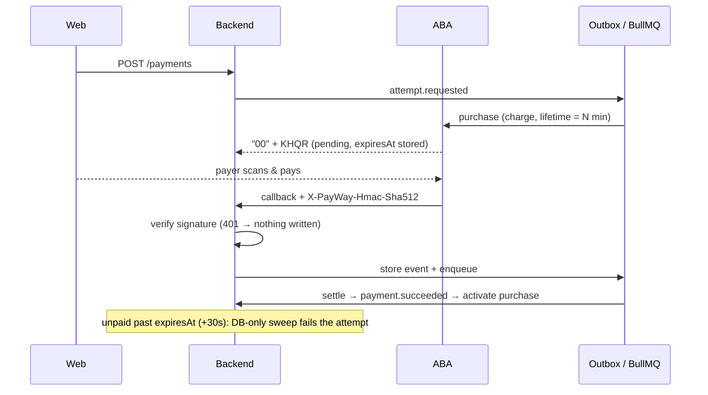

# ABA PayWay provider

PayWay's implementation of the `PaymentGatewayProvider` seam (contract:
[`../payment-gateway.interface.ts`](../payment-gateway.interface.ts), module
overview: [`../../README.md`](../../README.md)). The only code that knows
PayWay's wire format. Endpoint shapes: [`spec.md`](spec.md).

## Architecture

### Webhook-only: ABA pushes the result, ABA enforces the expiry

`charge()` only creates a KHQR checkout — the attempt stays `pending`. There is
**no polling of ABA**: the signed callback is the source of truth (the provider
sets `trustsVerifiedWebhook`, so a verified callback settles directly), and
expiry comes from ABA's `lifetime` (`ABA_PAYWAY_LIFETIME_MINUTES`) — after it ABA
rejects the payment and reverses the funds. Our side is closed by a DB-only
sweep (no ABA call) once the stored `expiresAt` passes. Bakong, which has no
webhook, is the provider that polls.

Without `ABA_PAYWAY_WEBHOOK_URL` ABA can never confirm a payment, so the
provider reports itself unavailable (hidden in the checkout picker) rather than
falling back to polling.

| File                                              | Purpose                                                                                           |
| ------------------------------------------------- | ------------------------------------------------------------------------------------------------- |
| `aba-payway.provider.ts`                          | `charge()`, `reconcile()`, `verifyWebhookSignature()`, `parseWebhookEvent()`, `redact()`          |
| `handlers/*.handler.ts`                           | The two network calls (`purchase`, `check-transaction-2`); return ABA's response as-is            |
| `aba-payway.signing.ts`                           | The three HMAC-SHA512 schemes                                                                     |
| `aba-payway.encoding.ts`                          | base64 for `return_url`; `req_time` (`YYYYMMDDHHmmss` UTC)                                        |
| `aba-payway.status.ts`                            | ABA status → `pending` / `succeeded` / `failed`                                                   |
| `aba-payway.types.ts`                             | Wire types                                                                                        |
| `../../webhooks/aba-payway-webhook.controller.ts` | Callback route: `POST /api/v1/payments/webhooks/aba-payway` (legacy alias `/webhooks/aba-payway`) |

It uses the outbox (the callback is stored + enqueued in one transaction) and
BullMQ (the queue worker runs `processProviderEvent`), like the rest of the
payment module.

### Signing — three schemes, not interchangeable

All are HMAC-SHA512 keyed by `ABA_PAYWAY_API_KEY`, base64-encoded.

- **purchase** (`signAbaPaywayPurchase`): 23 fields concatenated in a fixed order
  (`req_time, merchant_id, tran_id, amount, items, shipping, firstname,
lastname, email, phone, type, payment_option, return_url, cancel_url,
continue_success_url, return_deeplink, currency, custom_fields,
return_params, payout, lifetime, additional_params, google_pay_token,
skip_success_page`). An unset field is `''` **at its position** — skipping it
  would shift every later field. Sign the values exactly as sent.
- **check-transaction** (`signAbaPayway`): `req_time + merchant_id + tran_id`.
- **callback** (`verifyAbaPaywayCallbackSignature`): sort the payload's keys,
  concatenate the values (non-strings JSON-encoded), compare in constant time
  with the `X-PayWay-Hmac-Sha512` header. Generic over whatever keys arrive.

### Two things easy to get wrong

- **`return_url` is a server-to-server callback target**, not a browser
  redirect. It is always `ABA_PAYWAY_WEBHOOK_URL` (never caller input) and is the
  only base64-encoded URL. `continue_success_url` / `cancel_url` are the payer's
  browser redirects, caller-supplied, sent plain.
- **`tran_id` is a short random id we generate** (20 chars), not our UUID — ABA
  rejects more than ~25. ABA echoes it back in the callback and check-transaction;
  it is stored as `payment_attempts.provider_attempt_id` and is how everything
  correlates to an attempt.

## Lifecycle, end to end

Key properties:

- A bad or unsigned callback is rejected before any write.
- A verified callback is final — nothing else is asked of ABA, so there is no
  per-payment request rate to manage.
- Retries dedupe on `tran_id:status`, and ABA is always answered `{code: 0}`.
- After the lifetime ABA itself refuses payment, so failing the attempt on
  expiry cannot strand money. A webhook that loses the race to the sweep (or
  the sweep to the webhook) is resolved by the version guard — one wins.

## Configuration

| Var                           | Used for                                                                                            |
| ----------------------------- | --------------------------------------------------------------------------------------------------- |
| `ABA_PAYWAY_API_KEY`          | Signing requests and verifying callbacks                                                            |
| `ABA_PAYWAY_MERCHANT_ID`      | Every request                                                                                       |
| `ABA_PAYWAY_BASE_URL`         | Defaults to `https://checkout-sandbox.payway.com.kh`                                                |
| `ABA_PAYWAY_WEBHOOK_URL`      | Public URL of the callback route (`return_url`); needs a tunnel locally                             |
| `ABA_PAYWAY_LIFETIME_MINUTES` | How long a checkout stays payable (ABA `lifetime`, min 3). Default 15; ABA's own default is 30 days |

All but the lifetime are optional at boot. While the key, merchant id or webhook
URL is missing the provider is unavailable: `charge()` throws and the webhook
rejects (fail closed).

## Current state

| Piece                               | Status                                                                     |
| ----------------------------------- | -------------------------------------------------------------------------- |
| `charge()`                          | Done — confirmed against the sandbox                                       |
| `reconcile()`                       | Kept (check-transaction works) but unused for ABA: no polling              |
| Expiry (`lifetime` + sweep)         | Done — unit-tested; not yet run against the live sandbox                   |
| Callback verify + parse             | Done — a real sandbox callback verified and settled a payment (2026-10-16) |
| Unit tests                          | Signing, encoding, status, provider, and the controller — all offline      |
| `transaction-detail`/`close`/`list` | Not implemented, not needed yet                                            |

## Open items

- **Callback `status` codes other than `0` are undocumented.** Any other
  integer is treated as `failed`; a non-integer is `unknown` (never approval).
- **No refunds or chargebacks.** The `tran_id:status` dedupe would treat a
  later status for the same transaction as a new event; untested for refunds,
  which the provider doesn't model.
- **A missed callback is not recovered.** With no polling, a payment whose
  callback never arrives (our server down past ABA's retries, a bad
  `ABA_PAYWAY_WEBHOOK_URL`) stays `pending` until it expires. Keep the URL
  reachable; `reconcile()` is there if a recovery path is ever wanted.
- **The callback carries no amount/currency**, and nothing else confirms them
  now: we rely on ABA charging the amount we put in the QR.

## Confirmed against the live sandbox

Things the docs got wrong or omit: the base URL (`…payway.com.kh`), `req_time`
format, the 23-field purchase hash, the `tran_id` length limit, the
`Accept: application/json` requirement, the real purchase response shape
(`qrString`/`qrImage`), `status` beside `data` in check-transaction, and the
callback being 3 fields with a numeric `status`.
