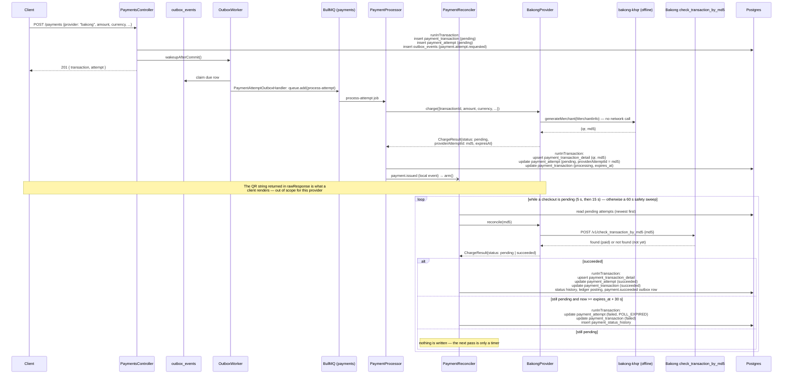

# Bakong (KHQR) provider

Bakong's implementation of the `PaymentGatewayProvider` seam (see
[`../payment-gateway.interface.ts`](../payment-gateway.interface.ts) and the
[payment module README](../../README.md) for the general contract). This is
the one provider in this module that isn't shaped like a normal payment
gateway integration, and that shape mismatch is the whole reason this
directory — and the poll loop it drives in `../../use-cases/` and
`../../processors/` — exists.

## Architecture

### There's no "create transaction" call, and no webhook — polling stands in for both

Every other provider this interface was designed around (ABA PayWay is the
existing example) works the same way: a server-side call creates a checkout
session, and the provider later pushes a webhook when the payer finishes.
Bakong does neither:

- **Generating a KHQR is a local, offline operation.** The `bakong-khqr`
  SDK builds the EMV QR string (and its MD5, which becomes Bakong's only
  handle on the transaction) entirely in-process — no request leaves this
  service to "create" anything. `charge()` therefore always either fails
  synchronously (a KHQR the SDK itself rejects — bad amount, missing
  merchant field) or returns `pending` immediately; there is no "checkout
  session created, awaiting payment" network round trip to fail on.
- **Bakong never calls us back.** There is no webhook, signed or
  otherwise, for a KHQR payment. The only way to learn whether a payer
  scanned and paid is to ask — repeatedly — via
  `POST /v1/check_transaction_by_md5`.

That second point is what makes this provider's `charge()` fundamentally
incomplete on its own: returning `pending` and stopping there would leave
the attempt stuck forever, because nothing is ever going to tell it
otherwise unless something keeps asking. `PaymentReconciler` is that
something — armed by a `payment.issued` event when a checkout is issued,
idle when nothing is open — and it is the _only_ path to a resolved status
for an attempt charged through this provider. See
[Where the poller fits](#where-the-poller-fits--demand-driven-one-poller)
and [Lifecycle, end to end](#lifecycle-end-to-end) for the full loop.

### Individual vs merchant accounts

`bakong-khqr` has two KHQR generation entry points, and they need genuinely
different setup, not just different field names:

- **`merchant`** (`MerchantInfo`/`generateMerchant`) needs a registered
  `merchantId` + `acquiringBank` — obtained by onboarding as a merchant
  through a participating bank/PSP. This is real business registration,
  not something either side of this codebase can generate.
- **`individual`** (`IndividualInfo`/`generateIndividual`) needs neither —
  just a personal Bakong account alias (`name@bank`, the one anyone with a
  Bakong-linked bank account already has). No onboarding required.

`BAKONG_MERCHANT_TYPE` (`individual` | `merchant`, defaults to
`individual`) picks which one `BakongProvider` builds
(`BakongAccountConfig` in `bakong.types.ts` — a discriminated union, not
one shape with optional fields, since the two really do need different
inputs). `createBakongTransaction` branches on `account.type` to call the
matching SDK entry point. The default favors `individual` because it's the
zero-setup path — an environment with no merchant credentials at all still
works for KHQR generation; switching to `merchant` is an explicit opt-in
once real merchant credentials exist.

### One file per concern

| File                                     | Purpose                                                                                                                                                                                                                         |
| ---------------------------------------- | ------------------------------------------------------------------------------------------------------------------------------------------------------------------------------------------------------------------------------- |
| `bakong.provider.ts`                     | Implements `PaymentGatewayProvider` — `charge()`, `reconcile()`, `verifyWebhookSignature()`, `parseWebhookEvent()`, `redact()`. The thin Promise boundary; see below.                                                           |
| `bakong.types.ts`                        | `BakongAccountConfig` and the `check_transaction_by_md5` wire types.                                                                                                                                                            |
| `bakong.status.ts`                       | `toPaymentAttemptOutcome` — maps a `check_transaction_by_md5` response onto `payment_attempts.status`.                                                                                                                          |
| `bakong-khqr.d.ts`                       | Ambient type declarations for the `bakong-khqr` SDK, which ships none of its own.                                                                                                                                               |
| `handlers/create-transaction.handler.ts` | `createBakongTransaction` — the create-transaction _action_: builds the KHQR via the SDK. No network call, no error channel (see below).                                                                                        |
| `handlers/check-transaction.handler.ts`  | `checkBakongTransaction` — the check-transaction _action_: the one real network call this provider makes.                                                                                                                       |
| `../../../utils/api-client.ts`           | Shared axios+Effect HTTP client (originally written for this provider, promoted out to `src/utils/` once it became clear any provider making a plain REST call could reuse it — ABA still does its own `fetch()`, unconverted). |

No `Entity map` subsection — this provider owns no database tables; it only
produces rows in tables the module already owns (`payment_attempts`,
`payment_transaction_details`, `outbox_events`).

### Handlers are the actions; the provider is the adapter

`createBakongTransaction`/`checkBakongTransaction` are written as `Effect`s
(`Effect.fn`, matching `../../use-cases/`'s convention), not NestJS-injectable
classes, specifically so they compose the way the rest of this module's
business logic does: typed failures (`ApiClientError` from
`checkBakongTransaction`, nothing at all from `createBakongTransaction` —
see its own doc comment), a free tracing span from `Effect.fn`'s name
argument, and an easy seam to hang retry/timeout combinators on later
without a rewrite.

`PaymentGatewayProvider` itself has to stay Promise-based — both NestJS DI
and the interface contract require it — so `BakongProvider` is the thin
boundary that runs those Effects and adapts their result into
`ChargeResult`/`ParsedProviderEvent`, the same role `PaymentEffectRunner`
plays for the controllers (`Effect.runPromise`, not
`PaymentEffectRunner` itself, since this runs from inside a plain
`PaymentGatewayProvider` method rather than a controller action).

### Where the poller fits — demand-driven, one poller

An earlier design polled through a self-rescheduling chain (outbox row →
BullMQ delayed job → Bakong call → next outbox row), with the reconciler as a
second poller behind it. That asked Bakong twice per pending payment and wrote
up to ~25 outbox rows and Redis jobs per abandoned QR. It is retired:
`PaymentReconciler` is the **only** poller, and it works only while there is
something to look at.

- **`processPaymentAttempt`** (shared, `../../use-cases/`) calls `charge()` and,
  on `pending`, commits the attempt (`providerAttemptId = md5`) and the
  transaction's `expires_at` (the KHQR's own expiry — `charge()` returns it at
  the top level, as ABA's does). It schedules **nothing**: the committed
  `pending` row in Postgres is the whole handoff.
- **`payment.issued`** is a local, non-durable `EventEmitter2` event
  (`PAYMENT_ISSUED_EVENT`, `../../payment.constants.ts`) that `PaymentProcessor`
  emits after a `process-attempt` job returns `pending`. `PaymentReconciler`
  listens and calls `arm()`, which starts a pass within 5 s instead of waiting
  out the safety sweep. It is advisory only — Postgres stays the source of
  truth, so a lost event (a checkout issued on another instance, a restart)
  costs at most one sweep interval, never a payment.
- **`PaymentReconciler`** (`../../reconciler/payment-reconciler.service.ts`)
  reads every unresolved attempt for `PAYMENT_RECONCILE_PROVIDERS` (default
  `bakong`) straight from Postgres and settles through one idempotent path
  (`settleReconciledAttempt`). Pacing comes from `nextTickDelayMs`:

  | State seen by the last pass                    | Next pass in                                             |
  | ---------------------------------------------- | -------------------------------------------------------- |
  | A pending checkout younger than 60 s           | 5 s (the payer is probably scanning)                     |
  | A pending checkout older than that             | `PAYMENT_RECONCILE_INTERVAL_MS` (15 s)                   |
  | Just settled / activated / abandoned / errored | `PAYMENT_RECONCILE_INTERVAL_MS`                          |
  | Nothing pending                                | `PAYMENT_RECONCILE_IDLE_INTERVAL_MS` (60 s safety sweep) |

  Pending attempts are read newest-first with their own cap (100), so a pile of
  abandoned checkouts cannot push the one a payer is watching past the limit.

- **`reconcilePaymentAttempt`** asks Bakong **first**, then judges the clock:
  a paid answer settles; an unpaid answer fails the attempt `POLL_EXPIRED`
  only once `transaction.expires_at` + 30 s has passed (or the 15-minute age
  backstop, for a row with no recorded expiry). A payer at the deadline, or a
  poll that ran late, therefore still settles. A gateway error throws — it
  never fails a paid attempt.
- **Attempts we gave up on** (`POLL_EXPIRED` / `POLL_GATEWAY_ERROR`) stay
  re-checkable for `PAYMENT_LATE_PAYMENT_GRACE_MS` (24 h) in case money lands
  late, but on a slow clock of their own — one look every 5 minutes, capped at
  50 per pass — never on the tight loop.
- **`PaymentOnDemandReconciler`** (`../../reconciler/payment-on-demand-reconciler.service.ts`):
  `GET /payments/:id` (after its owner check) nudges an open attempt along, at
  most one Bakong call per attempt per 5 s per instance (`ThrottleGate`),
  waiting no longer than 4 s. The response still comes from the database; it
  re-reads only if the check resolved something. On a serverless instance this
  is also what keeps the check running while a payer is on the page.
- **Legacy drain.** `PaymentPollOutboxHandler` and the `poll-attempt` job
  branch in `PaymentProcessor` are now no-ops that mark old
  `payment.attempt.poll_requested` rows / delayed jobs finished. They exist
  only because an unregistered outbox event type is retried and then marked
  `failed`. Delete them, with `PAYMENT_ATTEMPT_POLL_OUTBOX_EVENT_TYPE`, once
  no such row can remain (`OUTBOX_RETENTION_DAYS`).

## Lifecycle, end to end

Key properties this gives us:

- **No webhook route exists for this provider, on purpose.**
  `verifyWebhookSignature()` always returns `{valid: false}` and
  `parseWebhookEvent()` throws if it's ever reached — there's no signature
  to check and no payload shape to parse, because Bakong never sends
  either. This is an honest model of "no channel exists", not a stub
  standing in for one that should.
- **Polling exists only while there is demand.** With nothing pending the only
  activity is the 60 s safety sweep (activation + expiry + candidate queries);
  an unpaid QR costs a bounded number of Bakong calls — about 12 in its first
  minute and 15 s-spaced ones until it expires (≈5 minutes), not a fixed timer
  forever. An abandoned QR then costs one look per 5 minutes inside the grace
  window.
- **Durability does not depend on the event, the browser or the timer.** The
  only thing that must commit is the `pending` attempt with its `md5`; every
  later step reads that from Postgres. A payer who pays and refreshes, an
  instance that restarts, or a missed `payment.issued` just means the next pass
  finds the same row. Settlement is version-guarded, the ledger post is keyed on
  the transaction id and `payment.succeeded` has a dedupe key, so two instances
  (or the poller and an on-demand read) racing settle exactly once.
- **A pending attempt cannot poll forever.** It is abandoned at the KHQR's own
  expiry (+30 s), with the 15-minute age backstop behind it, and stays only in
  the slow late-payment tail afterwards.
- **A serverless instance polls only while it is alive.** Timers and the
  event live in the process. A QR paid while nobody is on the checkout page
  and no instance is running waits for the next request or boot (the boot pass
  runs immediately). Closing that gap needs an external trigger or an
  always-on worker — an open decision, see Open items.
- **`reconcile()` is primary here, not a fallback.** Contrast ABA, where
  `reconcile()` only ever corroborates an already-received webhook — for
  Bakong it's the sole source of truth.

## Configuration

| Var                        | Required for                                                                                                                                                                       |
| -------------------------- | ---------------------------------------------------------------------------------------------------------------------------------------------------------------------------------- |
| `BAKONG_MERCHANT_TYPE`     | Picks `individual` or `merchant` KHQR generation — see [Individual vs merchant accounts](#individual-vs-merchant-accounts). Defaults to `individual`.                              |
| `BAKONG_ACCOUNT_ID`        | Every `charge()` call, both account types — the Bakong account alias (`name@bank`) KHQR is generated against.                                                                      |
| `BAKONG_MERCHANT_NAME`     | Every `charge()` call, both account types — the display name on the KHQR (a person's name for `individual`, a business name for `merchant`).                                       |
| `BAKONG_MERCHANT_CITY`     | Every `charge()` call, both account types. Defaults to `Phnom Penh`.                                                                                                               |
| `BAKONG_MERCHANT_ID`       | Only when `BAKONG_MERCHANT_TYPE=merchant`.                                                                                                                                         |
| `BAKONG_ACQUIRING_BANK`    | Only when `BAKONG_MERCHANT_TYPE=merchant`.                                                                                                                                         |
| `BAKONG_QR_EXPIRY_SECONDS` | How long a generated KHQR stays valid — becomes `poll.expiresAt`. Defaults to `300` (5 minutes).                                                                                   |
| `BAKONG_API_KEY`           | The only network call this provider makes: `reconcile()` → `check_transaction_by_md5`. A bearer token, not a signing key — nothing here is HMAC-signed the way ABA's requests are. |
| `BAKONG_BASE_URL`          | Defaults to `https://api-bakong.nbc.gov.kh`.                                                                                                                                       |

Polling cadence is not configured here. It belongs to the payment module's
`PAYMENT_RECONCILE_*` variables — `PAYMENT_RECONCILER_ENABLED`,
`PAYMENT_RECONCILE_PROVIDERS` (default `bakong`),
`PAYMENT_RECONCILE_INTERVAL_MS` (15 s) and
`PAYMENT_RECONCILE_IDLE_INTERVAL_MS` (60 s) — plus
`PAYMENT_PENDING_ABANDON_MS` (15 min age backstop) and
`PAYMENT_LATE_PAYMENT_GRACE_MS` (24 h). `BAKONG_POLL_INTERVAL_MS` no longer
exists; a value left in `.env` is ignored.

All are optional at the `ConfigModule` level so the app can boot without
Bakong credentials, but `charge()` throws immediately if `BAKONG_ACCOUNT_ID`
or `BAKONG_MERCHANT_NAME` is unset, and additionally if
`BAKONG_MERCHANT_ID`/`BAKONG_ACQUIRING_BANK` are unset while
`BAKONG_MERCHANT_TYPE=merchant`; `reconcile()` throws immediately if
`BAKONG_API_KEY` is unset. A misconfigured environment fails the first time
it's actually used, with a clear message, rather than sending Bakong a
malformed request. Note the split: an environment can be fully configured
for KHQR generation (`charge()` works) while still failing every poll
(`reconcile()` doesn't) if only `BAKONG_API_KEY` is missing — the two
failure points are independent and it's worth checking both when Bakong
"isn't working".

## Current state

| Piece                                              | Status                                                                                                                                                                                                                                                                                                                             |
| -------------------------------------------------- | ---------------------------------------------------------------------------------------------------------------------------------------------------------------------------------------------------------------------------------------------------------------------------------------------------------------------------------- |
| `charge()` (KHQR generation)                       | Done — fully offline via `bakong-khqr`'s `generateMerchant()`/`generateIndividual()` (`BAKONG_MERCHANT_TYPE`-selected). Always dynamic (carries an amount), so always returns a top-level `expiresAt`, which `processPaymentAttempt` stamps on `payment_transactions.expires_at`.                                                  |
| `reconcile()` (`check_transaction_by_md5`)         | Done, against the production Bakong Open API base URL by default.                                                                                                                                                                                                                                                                  |
| Polling (`PaymentReconciler` + `payment.issued`)   | Done — one demand-driven poller, armed on issue, idle between payments. See [Lifecycle](#lifecycle-end-to-end). Unit-tested with a mocked database and provider; not run against a live Bakong or a booted app.                                                                                                                    |
| On-demand check (`PaymentOnDemandReconciler`)      | Done — `GET /payments/:id` nudges an open attempt, throttled to one Bakong call per attempt per 5 s per instance. Unit-tested the same way.                                                                                                                                                                                        |
| Legacy poll-chain drain                            | Done — no-op handler and job branch for rows/jobs written before the switch. Safe to delete later (see [Architecture](#where-the-poller-fits--demand-driven-one-poller)).                                                                                                                                                          |
| `verifyWebhookSignature()` / `parseWebhookEvent()` | Deliberately always-invalid / throwing — no webhook channel exists for this provider (see [Architecture](#architecture)), not an unimplemented stub.                                                                                                                                                                               |
| `redact()`                                         | Identity function — `check_transaction_by_md5`'s documented fields (`fromAccountId`/`toAccountId` are account _aliases_, not raw numbers) carry nothing that looks like a secret, but this hasn't been checked against a real response (see [Open items](#open-items)).                                                            |
| `util/api-client.ts` security hardening            | Baseline only: HTTPS-only base URL enforced, AxiosError sanitized before it becomes `ApiClientError.cause` (so a bearer token can never leak through a logged failure). Response schema validation, retry/backoff, host allowlisting, mTLS, and request signing are explicit `TODO(security)`s in that file, not silently skipped. |
| Unit tests                                         | The poller's policy, timer and candidate selection (`reconciler/*.spec.ts`), the throttled read, and the legacy drain. None for the provider itself or the processor's `payment.issued` emit — those import `effect`, which is ESM-only under Jest (see the payment README's Open items).                                          |
| Live verification                                  | None — no live Bakong sandbox credentials, and no real `check_transaction_by_md5` call, have been exercised in this environment.                                                                                                                                                                                                   |

## Open items

- **A serverless backend only polls while an instance is alive.** The timer,
  the `payment.issued` event and the BullMQ consumer all live in the process.
  Two things keep a payment moving: the boot pass (a payment made while the app
  was down is settled as soon as it is back) and the on-demand check on
  `GET /payments/:id` (a payer on the page generates requests). A QR paid while
  nobody is on the page and no instance is running waits for the next request.
  Options, owner's decision (`Plans.md` Task 2.1): an external pinger hitting a
  secret-protected endpoint every 1–5 minutes (free; detection can lag by the
  interval), or a small always-on worker (`APP_ROLE=worker`; seconds; the only
  setup where Postgres `LISTEN/NOTIFY` would be viable). `LISTEN/NOTIFY` was
  considered and rejected for now: it needs a long-lived session connection, a
  notification is lost if nobody is listening (so a table sweep is still
  required), and Bakong never notifies us, so something must still ask.
- **Batching MD5s is not built, and the endpoint is unverified.** Third-party
  SDKs wrap `POST /v1/check_transaction_by_md5_list` (one call for up to 50
  hashes), but NBC's published Open API guide does not list it and no source
  gives a request or response schema. A wrong per-MD5 mapping could mark an
  unpaid attempt as paid, so it should not be written against a guess: get a
  real response (needs `BAKONG_API_KEY`) or NBC's confirmation first.
- **A possible daily request limit on the Bakong Open API is unconfirmed.**
  One third-party source says the registration portal states 100 requests per
  day. If true it caps how many checkouts can be polled at all and would
  change the cadence in this README. Confirm on the Bakong developer portal
  before real traffic.
- **`check_transaction_by_md5`'s field names are doc-derived, not
  independently verified.** `bakong.types.ts`'s `CheckTransactionByMd5*`
  interfaces come from NBC's publicly published Bakong Open API
  documentation — the same class of caveat as ABA's unverified hash field
  order (see `../aba-payway/README.md`'s Open items). If a live call comes
  back with different field names or a different `responseCode` convention
  than assumed, `bakong.status.ts`'s `toPaymentAttemptOutcome` is the first
  place to recheck. Note it settles on `responseCode === 0 && data` alone: it
  does not compare the paid amount, currency or destination account with the
  attempt, which is worth adding once a real response is known.
- **Late-payment grace is still 24 hours.** An abandoned QR is now re-asked
  about only every 5 minutes, but for the whole `PAYMENT_LATE_PAYMENT_GRACE_MS`.
  Shortening it to the QR expiry plus a margin would stop that work, but only
  if Bakong refuses to pay an expired dynamic KHQR — not verified (`Plans.md`
  Task 1.3).
- **ABA checkouts also arm the reconciler.** `payment.issued` is emitted for
  any `pending` charge; for a webhook-only provider the pass finds no polled
  candidates and goes back to sleep. Harmless, one cheap pass per checkout.
- **Deeplink generation isn't wired.** `bakong-khqr` can turn a KHQR string
  into an app-openable shortlink (`BakongKHQR.generateDeepLink`), which
  would be the natural value for `ChargeResult.redirectUrl` (the field
  ABA's `checkout_qr_url` fills). This provider currently leaves
  `redirectUrl` unset and returns only the raw `qr`/`md5` in `rawResponse`
  — a client has to render the QR itself. Deliberate scope cut, not an
  oversight — `generateDeepLink` needs its own NBC-hosted shortlink
  endpoint plus source-app metadata (`SourceInfo`) this codebase has no
  config for yet.
- **No admin/operator visibility into "how many attempts are currently
  polling" beyond querying `payment_attempts` directly** — there's no dashboard
  or metric surfacing poller health specifically. A pass only logs when it
  settled, activated, abandoned or errored something.
- **`api-client.ts`'s `TODO(security)` list applies here in full** — see
  that file directly. The most load-bearing gap for this specific provider
  is the missing response schema validation: `reconcile()` currently trusts
  whatever shape `check_transaction_by_md5` returns without decoding it
  against `CheckTransactionByMd5Response`.
